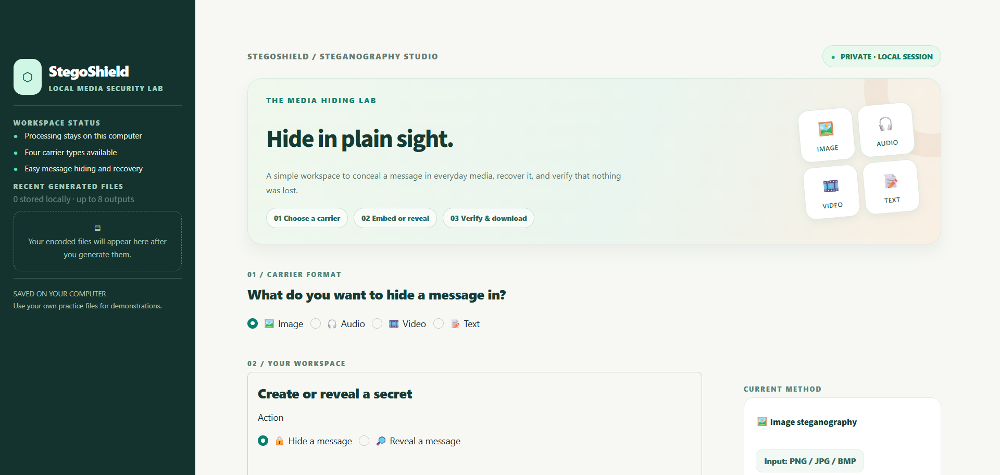
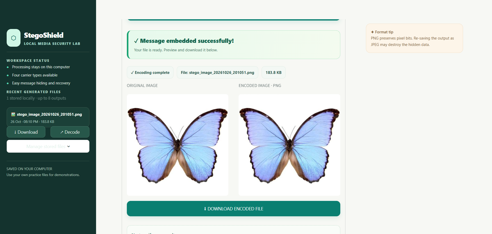
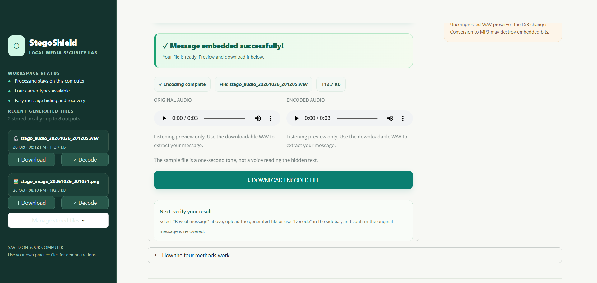
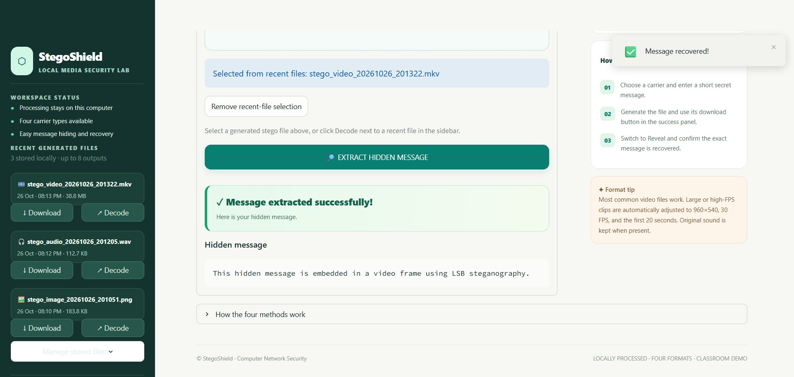
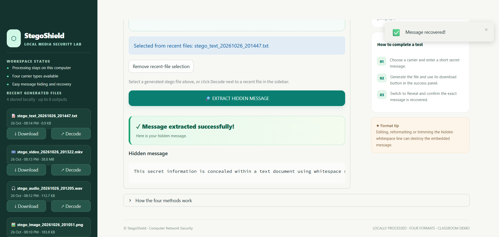

# 🛡️ StegoShield

### Multi-Format Steganography Studio

**Hide, recover, and demonstrate secret messages inside images, audio, video, and text — from one local web application.**

*A Computer Network Security (CNS) educational project, developed and demonstrated locally.*

[Overview](#overview) · [Features](#key-features) · [How It Works](#how-it-works) · [Setup](#installation--run-locally) · [Demo](#demonstration-guide) · [Testing](#testing)

---

## Application Screenshots

These screenshots show StegoShield running locally, including message embedding and successful extraction. Click an image to view it at full size.

  

<em>StegoShield dashboard — choose Image, Audio, Video, or Text and hide or recover a message.</em>

<table>
  <tr>
    <td width="50%" valign="top">
      
       <strong>Image — successful LSB embedding.</strong> 
      The original and encoded PNG images look virtually identical.
    </td>
    <td width="50%" valign="top">
      
       <strong>Audio — successful WAV embedding.</strong> 
      Play and compare the original and encoded sound.
    </td>
  </tr>
  <tr>
    <td width="50%" valign="top">
      
       <strong>Video — secret message recovered.</strong> 
      First-frame LSB extraction from the generated FFV1/MKV file.
    </td>
    <td width="50%" valign="top">
      
       <strong>Text — secret message recovered.</strong> 
      Whitespace-encoded TXT file decoded successfully.
    </td>
  </tr>
</table>

**Validation:** all four formats passed manual hide/extract demonstrations. The project's test suite also completed **25/25 tests** successfully.

## Overview

**StegoShield** is a Python application that demonstrates **steganography**: hiding information *inside* an ordinary digital carrier so the carrier can still be viewed, played, or read. It provides a single Streamlit dashboard for **encoding** a secret message into a file and **decoding** it afterward.

The project implements four distinct carrier workflows rather than four disconnected demos. A shared message format supports consistent extraction, while carrier-specific algorithms determine *where the hidden bits are stored*.

StegoShield is designed to make a security concept tangible: upload a carrier, type a message, generate an encoded file, then recover the exact message from that file.

> **Scope:** This is an educational information-hiding prototype, **not an encrypted messaging service**. Its output should not be relied on to protect sensitive information against forensic analysis.

## Key Features

- **Four working modules:** image, audio, video, and text steganography.
- **Two-way workflow:** embed a message and later extract it from the generated file.
- **Local Streamlit dashboard:** file upload, operation selection, clear results, and download actions.
- **Media previews:** compare original and encoded images, and listen to audio previews.
- **Video handling:** accept common formats, adapt large/high-frame-rate clips for a short demonstration, and retain source audio when available.
- **Recent-file vault:** locally stores up to eight generated outputs with download and decode shortcuts across app restarts.
- **Built-in test samples:** bundled image, WAV, MP4, and text examples.
- **Message integrity validation:** a small header and CRC32 checksum help detect incomplete or altered embedded data.
- **Automated tests:** 25 tests passed in the final local test run, in addition to successful demonstrations of all four modules.

## Supported Formats and Methods

| Carrier | Technique | Input | Generated file | What changes |
| --- | --- | --- | --- | --- |
| 🖼️ **Image** | RGB **least significant bit (LSB)** substitution | PNG, JPG/JPEG, BMP | Lossless **PNG** | Selected red, green, and blue channel bits |
| 🎧 **Audio** | PCM sample **LSB** substitution | Uncompressed PCM **WAV** | **WAV** | Lowest bit of selected audio samples |
| 🎞️ **Video** | **First-frame RGB LSB** + lossless FFV1 encoding | Common video files, including MP4, MOV, AVI, MKV, WebM | **MKV** with FFV1 video | Selected RGB values in the first decoded frame |
| 📝 **Text** | **ASCII whitespace encoding** | User-written paragraph or TXT | UTF-8 **TXT** | A separate line of spaces and tabs |

### What makes the formats different?

All methods begin by turning the secret message into bytes and bits. The difference is the carrier:

- An **image** stores bits in pixel color-channel values.
- **Audio** stores bits in uncompressed sound samples.
- A **video** stores bits in the pixels of its first frame; the remaining frames and soundtrack are not used as a hiding channel.
- **Text** stores bits as spaces and tabs after the visible paragraph.

## How It Works

~~~mermaid
flowchart TD
    A["Choose Image / Audio / Video / Text"] --> B["Upload or enter a cover carrier"]
    B --> C["Enter a secret message"]
    C --> D["Convert message to bytes and build payload"]
    D --> E{"Chosen carrier"}
    E -->|Image| F["Embed in RGB pixel LSBs"]
    E -->|Audio| G["Embed in PCM sample LSBs"]
    E -->|Video| H["Embed in first frame; encode lossless video"]
    E -->|Text| I["Encode as a line of spaces and tabs"]
    F --> J["Download stego file"]
    G --> J
    H --> J
    I --> J
    J --> K["Upload stego file or choose it from recent files"]
    K --> L["Read embedded bits and validate payload"]
    L --> M["Recover the original secret message"]
~~~

### Shared message structure

For reliable extraction, the application embeds a small binary packet:

| Packet component | Purpose |
| --- | --- |
| **STG1 marker** (4 bytes) | Identifies data created by StegoShield |
| **Message length** (4 bytes) | Tells the decoder how many message bytes to read |
| **UTF-8 message** (variable length) | Contains the hidden text |
| **CRC32** (4 bytes) | Detects accidental changes to the recovered data |

The packet adds **12 bytes of overhead** to the message. This simple structure lets the decoder reject ordinary files that do not contain a valid StegoShield payload. **CRC32 is error detection; it is not encryption or cryptographic authentication.**

## The Four Algorithms — Explained

### 1. Image Steganography: RGB LSB

Digital RGB images contain three color values per pixel. StegoShield reads those channel bytes and replaces each selected value's **least significant bit** with one bit of the message packet.

For example, changing **150** (binary **10010110**) to **151** (binary **10010111**) hides a binary **1** and alters the channel by only one intensity level.

**Encoding:** load image → convert to RGB → insert payload bits into channel LSBs → export PNG.

**Decoding:** open the stego PNG → read channel LSBs in the same order → reconstruct and validate the payload.

**Why PNG?** Lossless PNG preserves the embedded pixel bits. Saving the stego image as a lossy JPEG could damage the hidden data.

### 2. Audio Steganography: PCM LSB

Uncompressed WAV audio contains digital samples representing sound amplitude. StegoShield modifies the least significant bit of each selected PCM sample, using the sample width to move through the audio correctly.

**Encoding:** open PCM WAV → read samples → insert message bits into sample LSBs → write WAV with the original audio settings.

**Decoding:** read the same sample-bit positions → reconstruct and validate the message.

This usually produces very small sample changes. The original and encoded recordings can be played side by side in the dashboard. **MP3 is not a supported stego output**, because lossy audio conversion can change embedded bits.

### 3. Video Steganography: First-Frame LSB + FFV1

A video consists of individual frames. StegoShield first prepares a manageable video when the original clip is large or high-FPS. It then applies the **same RGB LSB principle used for images** to the **first decoded frame**.

**Encoding:** read video → optionally scale / adjust frame rate / shorten for demonstration → embed the payload in the first RGB frame → encode frames with **FFV1**, a lossless video codec → add the original source's audio track when present.

**Decoding:** open exported MKV → read the first decoded frame → recover and validate the bits.

**Why MKV/FFV1?** Common lossy video encoding modifies pixels and may destroy LSB data. The output uses a lossless FFV1 video stream in an MKV container. When a source soundtrack exists, StegoShield includes it in the output as an **AAC audio track**; this is not a byte-for-byte copy of the original audio.

**Demo processing bounds:** videos can be automatically adapted to **at most 960×540**, **30 FPS**, and the **first 20 seconds**. The output can be substantially larger than the input. For the best playback compatibility, use a media player that supports FFV1/MKV, such as VLC; browser video preview is not guaranteed.

### 4. Text Steganography: Spaces and Tabs

Text steganography in this project does **not** replace letters with unusual Unicode symbols. It keeps the visible paragraph intact and adds a separate **whitespace-only line**.

- Space represents binary **0**.
- Tab represents binary **1**.

**Encoding:** convert packet bytes to bits → convert bits into spaces and tabs → append that line after the cover paragraph → save as TXT.

**Decoding:** read the final whitespace line → convert spaces/tabs back to bits → reconstruct and validate the message.

The cover paragraph still reads normally in Notepad. However, the concealed whitespace **can be revealed by inspecting invisible characters**, and editors that trim or reformat whitespace can destroy the payload.

## Tech Stack

| Layer | Technology | Role |
| --- | --- | --- |
| Application UI | **Streamlit** | Local dashboard, forms, previews, file download |
| Language | **Python** | Core encoding/decoding and workflow |
| Image processing | **Pillow** | Load RGB images and save PNG outputs |
| Audio processing | Python standard library **wave** | Read and write uncompressed PCM WAV |
| Video processing | **imageio-ffmpeg / FFmpeg** | Video frames, FFV1/MKV export, soundtrack handling |
| Local history | Python file system + **JSON** | Save and load recently generated outputs |
| Validation | **pytest** | Automated round-trip and failure-case tests |

No database, API key, account, or hosted backend is required to run the application locally.

## Installation & Run Locally

### Requirements

- Python **3.10 or newer** with compatible package versions
- Windows, macOS, or Linux with the supported dependencies installed
- A modern browser
- Enough free disk space for temporary and exported video files

### Windows PowerShell (VS Code)

~~~powershell
git clone https://github.com/dhanushgowdars/StegoShield.git
cd StegoShield

py -3 -m venv .venv
.\.venv\Scripts\python.exe -m pip install -r requirements.txt
.\.venv\Scripts\python.exe -m streamlit run app.py
~~~

### macOS / Linux

~~~bash
git clone https://github.com/dhanushgowdars/StegoShield.git
cd StegoShield

python3 -m venv .venv
./.venv/bin/python -m pip install -r requirements.txt
./.venv/bin/python -m streamlit run app.py
~~~

Streamlit prints a local URL, usually **http://localhost:8501**. Open the URL in your browser. Press **Ctrl+C** in the terminal to stop the server.

> FFmpeg is accessed through the <code>imageio-ffmpeg</code> package. Support for individual input formats depends on the available FFmpeg build.

## Demonstration Guide

The <code>samples/</code> directory includes carriers for repeatable classroom demos.

| Demo | Hide | Reveal / verify |
| --- | --- | --- |
| **Image** | Select Image → upload <code>sample_image.png</code> → type message → create/download PNG | Select Reveal → upload the **new PNG** → recover the same text |
| **Audio** | Select Audio → upload <code>sample_audio.wav</code> → create/download WAV; listen to previews | Upload generated WAV → recover the text |
| **Video** | Select Video → upload <code>sample_video.mp4</code> or a compatible short video → create/download MKV | Upload generated MKV → recover the text from the first frame |
| **Text** | Select Text → enter a cover paragraph → create/download TXT | Open the TXT to inspect the visible paragraph, then upload it unchanged to recover the message |

For every demo, the easiest success check is **exact round-trip recovery**: the extracted text should match what was originally entered.

Generated outputs also appear in the **Recent Generated Files** sidebar. Use **Decode** on a saved item to open it for extraction without browsing for the file again.

### Expected result

~~~text
Encoding: Message embedded successfully!
Output:   Download the generated stego file

Decoding: Message extracted successfully!
Result:   The exact secret message entered during encoding
~~~

## Testing

The final Windows demonstration completed **all four hide/extract workflows**, including playable audio and video output with its source soundtrack retained.

The automated test suite also passed:

~~~text
25 passed in 2.28s
~~~

Run it yourself with:

~~~powershell
python -m pytest -q
~~~

Tests cover successful encoding/decoding, non-ASCII message text, image and WAV inputs, multiple PCM sample widths, text whitespace handling, damaged or absent payloads, video extraction, high-resolution/high-FPS adaptation, video shortening, and soundtrack presence in encoded video.

The green test count is from a **local run**, not a claim that GitHub Actions is configured or that the program has been independently security-audited.

## Project Structure

~~~text
StegoShield/
├── app.py                    # Streamlit interface and demo workflows
├── stegoshield/
│   ├── __init__.py
│   ├── core.py               # Image/audio/text steganography and payload format
│   ├── video.py              # First-frame video hiding and FFmpeg processing
│   └── history.py            # Recent encoded-file vault
├── samples/                  # Original sample image, WAV, MP4 and text
├── scripts/
│   └── generate_samples.py   # Regenerate example carriers
├── tests/
│   ├── test_core.py
│   ├── test_video.py
│   └── test_history.py
├── .streamlit/
│   └── config.toml           # UI theme and upload configuration
├── requirements.txt
├── LICENSE
└── README.md
~~~

The app creates a local <code>.stegoshield_data/</code> folder at runtime to store recent outputs. That folder, virtual environments, and other temporary files are excluded from Git.

## Practical Limits & Responsible Use

- **Not encryption:** anyone who understands the embedding technique may be able to extract or detect the message.
- **Not tamper-proof:** CRC32 identifies many accidental modifications but is not an authentication mechanism.
- **Carrier changes matter:** JPEG recompression, MP3 conversion, lossy video re-encoding, cropping, or text whitespace cleanup can damage the payload.
- **Supported formats differ:** audio requires uncompressed PCM WAV; video produces FFV1/MKV; text uses a whitespace-only line.
- **Demo boundaries:** the app limits uploads to **160 MB**; image processing is capped at **16 megapixels**; the secret message is capped at **100,000 UTF-8 bytes** subject to carrier capacity.
- **Video output:** uses a short processed portion of longer clips; resolution/frame-rate adjustments and AAC audio encoding mean it is not a bit-identical copy of the source.
- **Local saved files:** recent encoded outputs are stored **unencrypted** on disk. The vault retains up to eight recent files subject to a storage budget; clear them from the app when no longer needed.

Use your own or authorized sample media. This repository is intended for **learning, demonstrations, and experimentation**, not covert misuse or protection of actual confidential records.

## Troubleshooting

| Problem | What to try |
| --- | --- |
| <code>No module named streamlit</code> | Install requirements using the same Python interpreter that launches the app |
| <code>requirements.txt not found</code> | Run commands from the folder containing <code>app.py</code> and <code>requirements.txt</code> |
| Audio file is rejected | Use **uncompressed PCM WAV**, not a renamed MP3 |
| Encoded MKV does not preview in Chrome | Download it and open it in **VLC** or another FFV1-capable player |
| No hidden message found | Decode the **generated stego file**, not the original cover |
| Text extraction fails after editing | Re-create the file; text editors may delete the hidden spaces/tabs |
| Video processing takes time or produces a large file | Try a shorter input; FFV1 prioritizes lossless video data over small size |

## Learning Outcomes

Building and demonstrating StegoShield covers binary representation, least-significant-bit modification, basic image/audio/video formats, UTF-8 text processing, lossless encoding, data validation, file handling, automated tests, and the distinction between **steganography** and **cryptography**.

The four carrier types provide a practical way to compare how the **same secret message** can be hidden in very different media—and why reliable recovery depends on preserving the right underlying data.

## Author & License

**Developed by [Dhanush R S](https://github.com/dhanushgowdars)** as a Computer Network Security project.

Released under the **MIT License**; see [LICENSE](LICENSE).

---

**StegoShield — four carriers, one learning experience.**

